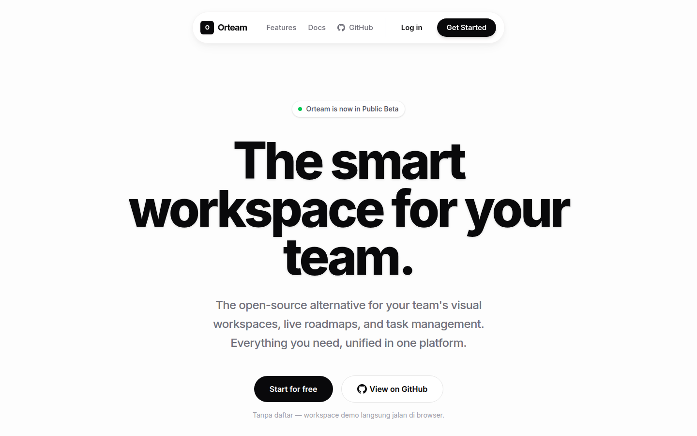
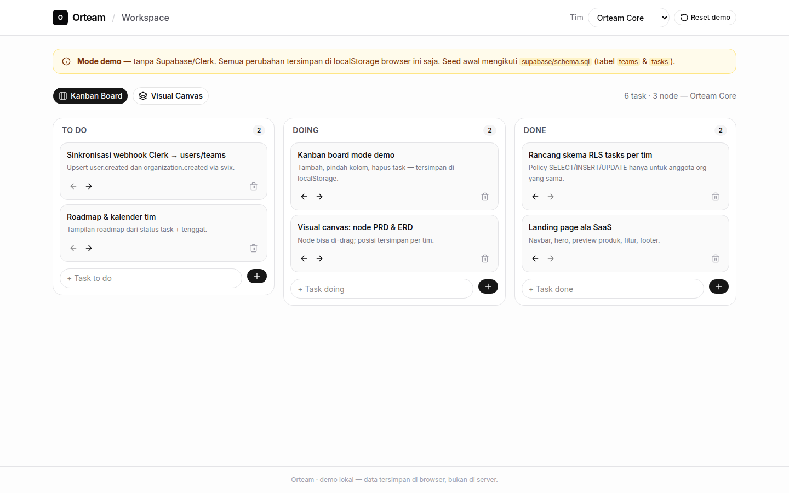
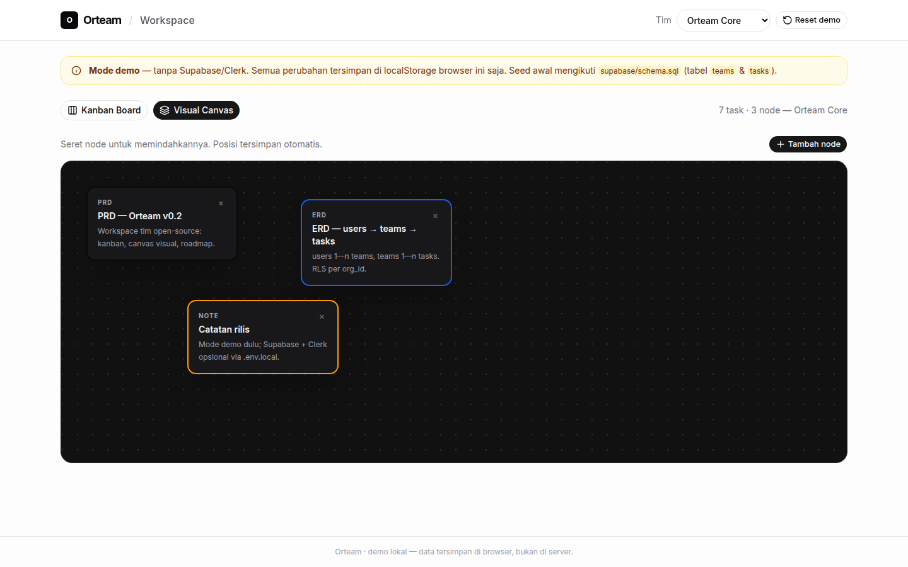
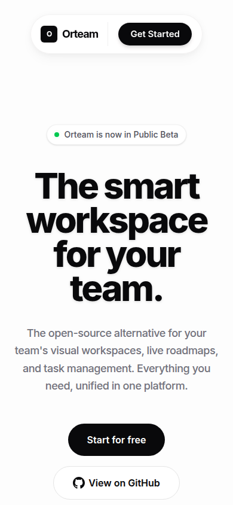

# Orteam

**The smart workspace for your team** — open-source alternative for visual
workspaces, live roadmaps, and task management. Everything you need, unified
in one platform.

🌐 **Live:** https://orteam.pages.dev
📄 **Docs:** [`docs/README.md`](./docs/README.md) · **PRD:** [`PRD.md`](./PRD.md)



## Coba langsung — tanpa daftar

Buka https://orteam.pages.dev, klik **Start for free**, dan workspace demo
langsung jalan di browser: Kanban board, visual canvas, ganti tim, reset demo.
Tanpa akun, tanpa kunci. Data tersimpan di localStorage.

📹 **Video demo:** [`docs/demo/demo.mp4`](./docs/demo/demo.mp4) (15 detik)

## Fitur

| Fitur | Status |
|---|---|
| Landing SaaS (navbar + GitHub, hero + preview, fitur, docs, footer) | ✅ |
| Kanban board — tambah, pindah kolom, hapus task (TODO/DOING/DONE) | ✅ mode demo |
| Visual canvas — node PRD/ERD/catatan yang bisa di-drag | ✅ mode demo |
| Multi-tim (Orteam Core, Hackathon PIDI) | ✅ mode demo |
| Skema Supabase + RLS (users, teams, tasks) | ✅ skema, belum dites live |
| Auth Clerk + webhook sync | 📋 didokumentasikan, belum diimplementasikan |
| Real-time sync (Yjs/Supabase Realtime), roadmap & kalender | 📋 fase 2–3 |

## Screenshot







Screenshot lengkap: [`docs/screenshots/`](./docs/screenshots/) — hero, full
landing, kanban sebelum/sesudah play-test, canvas, mobile.

## Tech stack

- **Frontend:** Next.js 16.4.6 (App Router, static export) + React 19 +
  Tailwind CSS v4 + shadcn/ui + lucide-react
- **Backend (opsional):** Supabase (PostgreSQL + RLS) — lihat
  [`supabase/schema.sql`](./supabase/schema.sql) dan
  [`docs/SCHEMA.md`](./docs/SCHEMA.md)
- **Auth (opsional):** Clerk — lihat [`docs/ARCHITECTURE.md`](./docs/ARCHITECTURE.md)
- **Python:** skill scripts di `.agents/skills/ui-ux-pro-max/scripts/`
  (stdlib-only, dites via unittest)
- **Deploy:** Cloudflare Pages (statis) — lihat
  [`docs/DEPLOYMENT.md`](./docs/DEPLOYMENT.md)

## Menjalankan

```bash
npm install
npm run dev      # http://localhost:3000

npm run build    # static export ke out/
npm run typecheck
npm run lint
```

Mode produksi (opsional): salin `.env.example` ke `.env.local` dan isi
`NEXT_PUBLIC_SUPABASE_URL` + `NEXT_PUBLIC_SUPABASE_ANON_KEY`. Tanpa itu
aplikasi tetap jalan dalam **mode demo**.

## Struktur proyek

```
src/app/            landing (/) + workspace (/workspace)
src/components/ui/  komponen shadcn/ui (button)
src/lib/            demo-data.ts (seed + localStorage), supabase/ (klien)
supabase/schema.sql skema users / teams / tasks + RLS
scripts/            advisory-sweep.py, serve.mjs (play-test lokal)
docs/               PRD, SDD, arsitektur, skema, keamanan, deploy, demo,
                    diagram HTML+SVG, screenshot, video demo
.agents/skills/     skill agen AI (termasuk skrip Python + tesnya)
```

## Keamanan

Tidak ada secret yang ter-commit (dipindai 18 Nov 2026). `shadcn` (CLI)
ada di `devDependencies`, bukan runtime. CI memakai
`scripts/advisory-sweep.py` — hanya dependensi produksi yang diperiksa
terhadap GitHub Advisory Database: **81 paket, 0 high/critical**.
Detail: [`docs/SECURITY.md`](./docs/SECURITY.md).

## Lisensi

MIT — lihat [LICENSE](./LICENSE).

---

_Dikembangkan oleh **dezzorigin** (Nabil Aulia Dika)._
